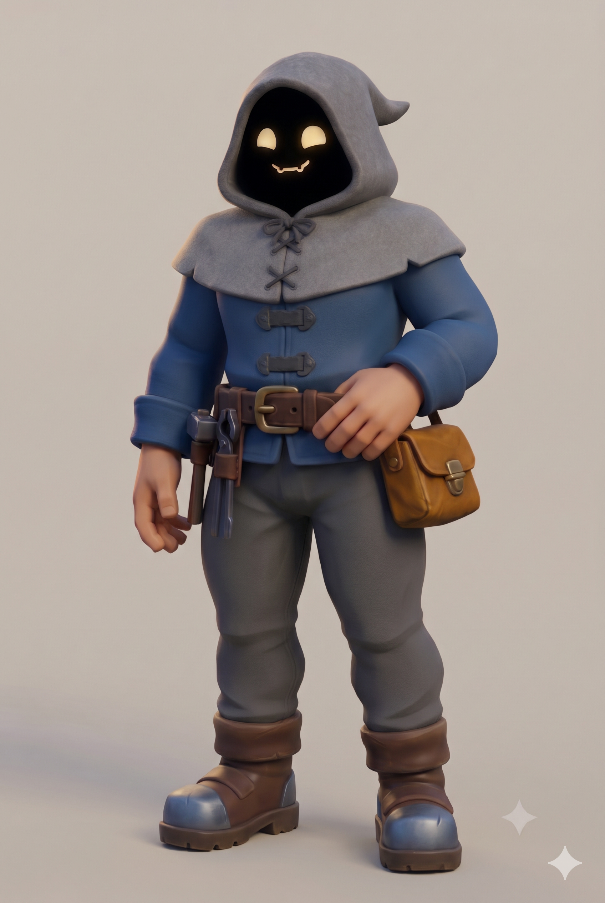
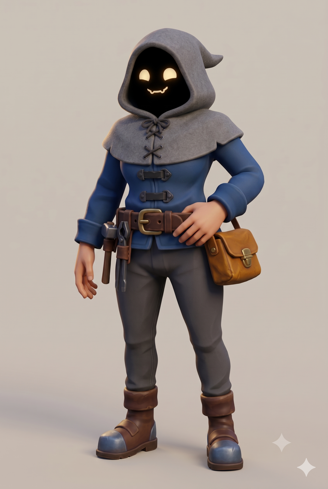

# Player — Art

> **Entity:** [E_Player](E_Player.md)

## Description

A mysterious hooded artisan: a weapon-smith from a magical workshop that floats between worlds. The face is hidden in the hood's darkness, where only two glowing eyes and a small crooked smile float, giving a cozy, mischievous personality. Stylized and chunky, about six heads tall counting the hood, with a sturdy build and oversized hands and boots that read from a distance. The forge identity comes from the tools on the belt; there is no smith's apron.

**Key visual elements:**

- Heather-grey felted wool hood ending in a short point, sewn to a short shoulder cape (a medieval gugel) with a laced front and a small bow at the throat.
- Void face: the hood opening is flat black, with pale-gold glowing eyes and a glowing smile, the only glowing elements on the character.
- Hip-length cobalt-blue canvas work coat closed by black leather straps with iron hook clasps. The coat is the per-player accent colour; the grey hood and the leather stay shared.
- Broad dark-brown leather belt with a large brass buckle, carrying a hammer, tongs and chisel on the right hip and a honey-brown satchel on the left.
- Dark grey trousers tucked into chunky brown leather boots with blue-grey iron toe caps.

## Palette

- <span style="color:#3A4A61;">■</span> `#3A4A61`
- <span style="color:#858087;">■</span> `#858087`
- <span style="color:#4C4240;">■</span> `#4C4240`
- <span style="color:#50332B;">■</span> `#50332B`
- <span style="color:#975C24;">■</span> `#975C24`
- <span style="color:#785E47;">■</span> `#785E47`
- <span style="color:#64697C;">■</span> `#64697C`
- <span style="color:#C89B7E;">■</span> `#C89B7E`
- <span style="color:#DBBB8A;">■</span> `#DBBB8A`
- <span style="color:#010005;">■</span> `#010005`

## Selected

| [01 Male](#01-male)    | [02 Female](#02-female)|
| ---------------------- | ---------------------- |
|  |  |

## History

### 02 Female


**Model:** Gemini (version not recorded)

Prompt not recorded.

### 01 Male


**Model:** Gemini 4 Argon

><details>
><summary>Prompt</summary>
>
>```
>A stylized 3D character concept render of a mysterious hooded artisan, a weapon-smith from a magical workshop that floats between worlds. Full-body three-quarter front view, the character standing in a relaxed, confident pose with one hand resting on the belt. A single character alone in the frame on a plain, light warm-grey background.
>
>Face: the character has no visible face. The opening of the hood is filled with flat, pure black darkness, an empty void with no skin, hair, nose or ears. Floating in this darkness are two large, rounded, softly glowing pale-gold eyes and a small, friendly, slightly crooked smile drawn as a thin glowing line with a few small rounded teeth. The eyes and mouth look painted onto the darkness, simple and expressive like a cartoon, giving the character a cozy, mischievous personality.
>
>Hood and cape: a deep hood of soft heather-grey felted wool, stiff enough that its thick rim keeps the inside in complete shadow. The hood ends in a short, natural point just behind the back of the head. It is sewn to a short shoulder cape of the same wool, in the style of a medieval gugel. The cape lies only on top of the shoulders and ends in a clean edge at the shoulder points, so the rounded outer sides of the shoulders and the upper arms show the coat. It closes down the chest with a laced front: four large cross-laces of dark cord and a small tied bow at the throat.
>
>Coat: a fitted long-sleeve work coat of deep cobalt-blue heavy canvas that ends at the hips, closed down the front by three chunky black leather straps fastened with dark iron hook clasps. The sleeves run all the way down to the wrists and end in a wide cuff band.
>
>Belt: a broad dark-brown leather belt, about a hand wide, with a large brass buckle, worn over the coat at the waist. Hanging from the belt: a small forging hammer in a leather loop at the right hip, a pair of iron tongs and a chisel in a tool sheath beside it, and a sturdy honey-brown leather satchel with a brass clasp on the left hip.
>
>Hands: large, sturdy human hands with warm-toned skin and short nails, emerging directly from the coat cuffs.
>
>Lower body: dark grey canvas trousers tucked into chunky brown leather boots with blue-grey iron toe caps.
>
>Proportions: an adult of average height, about 180 cm tall from the soles of the boots to the top of the hood. Stylized, about six heads tall counting the hood, sturdy build with broad shoulders, oversized hands and boots that read clearly from a distance.
>
>Style: stylized, chunky, hand-crafted PBR 3D render, like a modern cozy fantasy co-op game. Simplified, slightly exaggerated shapes 20 to 40 percent thicker than real life, softly beveled edges on every strap, buckle, clasp and boot, oversized buckles and rivets, simplified cloth folds. Surfaces carry soft hand-painted color variation and subtle edge wear, with a matte finish. Mundane materials stay muted and warm: grey wool, cobalt canvas, honey and dark-brown leather, blue-grey iron, warm brass. The eyes and mouth are the only glowing elements on the character. Smooth shading without outlines or cel shading.
>
>Lighting: soft, warm key light from the front-left with a gentle fill so every material reads clearly, a faint rim light separating the hood from the background, and a soft contact shadow under the boots. The inside of the hood stays in complete darkness.
>
>No text, no labels, no watermark, no logos, no frame or border.
>```
></details>
