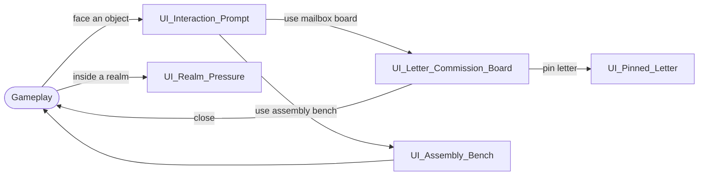

# UI Flow

> **Overview:** [Glossary](../00_Overview/Glossary.md) · **Naming:** [Assets Naming §7](../../Guidelines/Assets_Naming.md) · **Technical:** [_UI_Module](../../Technical_Design/UI/_UI_Module.md)

Categories: `Hud/` (screen-space overlays during play), `Menus/` (front-end and pause), `Screens/` (full interfaces opened from an object), `World/` (diegetic, world-space UI), `Widgets/` (shared components). Most of *Armotheca*'s UI is diegetic.

## Flow

## Screens

| ID | Category | Shows | Status |
| --- | --- | --- | --- |
| [UI_Letter_Commission_Board](Screens/UI_Letter_Commission_Board.md) | Screens | Letter queue, dossier, pin and dispatch | Draft |
| [UI_Pinned_Letter](Hud/UI_Pinned_Letter.md) | Hud | Pinned letter criteria | Draft |
| [UI_Realm_Pressure](Hud/UI_Realm_Pressure.md) | Hud | Current Realm Pressure level | Draft |
| [UI_Assembly_Bench](World/UI_Assembly_Bench.md) | World | Sockets, preview, incompatibility | Draft |
| [UI_Interaction_Prompt](World/UI_Interaction_Prompt.md) | World | Button, verb, object, hold progress | Draft |

## Planned

Referenced by other docs but not designed yet:

- Player health and downed / bleed-out display ([M_Health_And_Downed](../02_Systems/Combat/M_Health_And_Downed.md)).
- Backpack contents ([M_Carry_Model](../02_Systems/Interaction/M_Carry_Model.md)).
- Mob and Apex Guardian health ([_Mob_Roster](../03_Entities/Mobs/_Mob_Roster.md)).
- Processing mini-game displays ([M_Processing_Mini_Game](../02_Systems/Processing/M_Processing_Mini_Game.md)).
- "Upgrade affordable" hint and upgrade ledger ([M_Workshop_Tiers](../02_Systems/Progression/M_Workshop_Tiers.md)).
- Ritual phase display and campaign victory screen ([M_Forging_Ritual](../02_Systems/Endgame/M_Forging_Ritual.md)).
- Main menu, lobby, join and drop-in ([F07_Co_Op](../01_Features/F07_Co_Op.md)).

The UI visual style (fonts, colours, icons) is owned by Guidelines.
